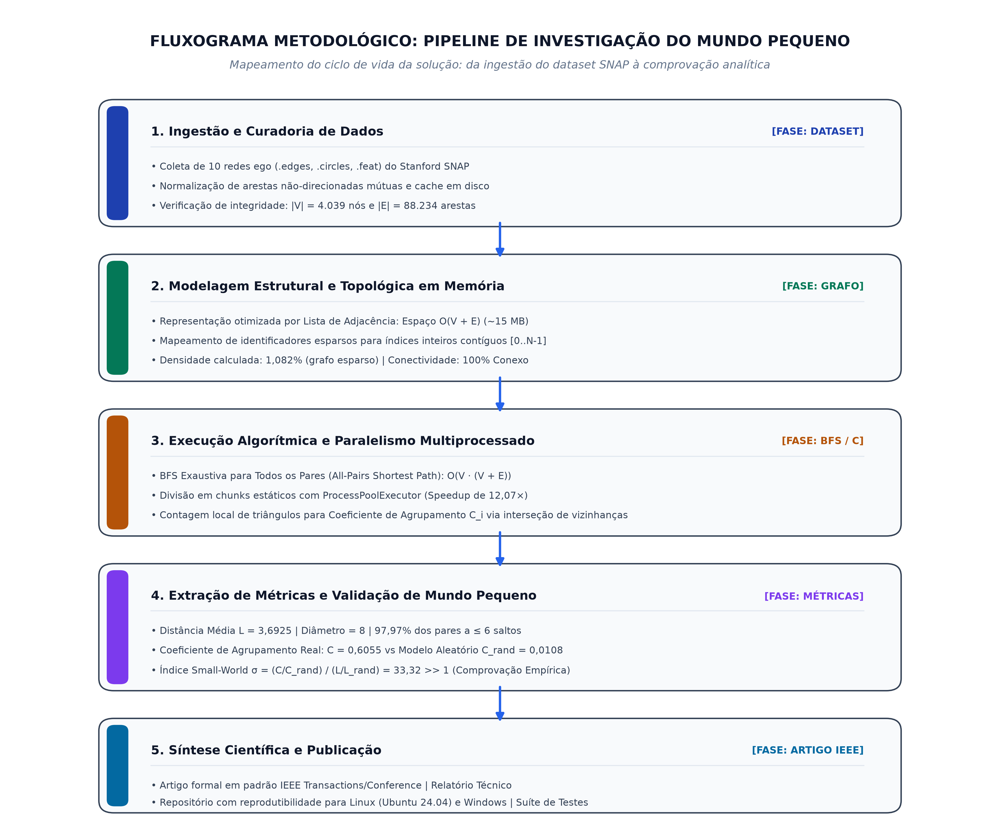
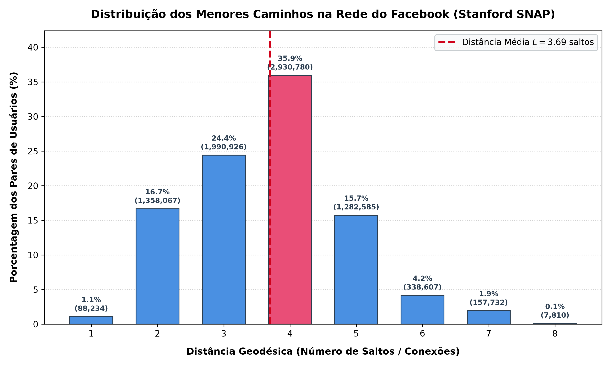
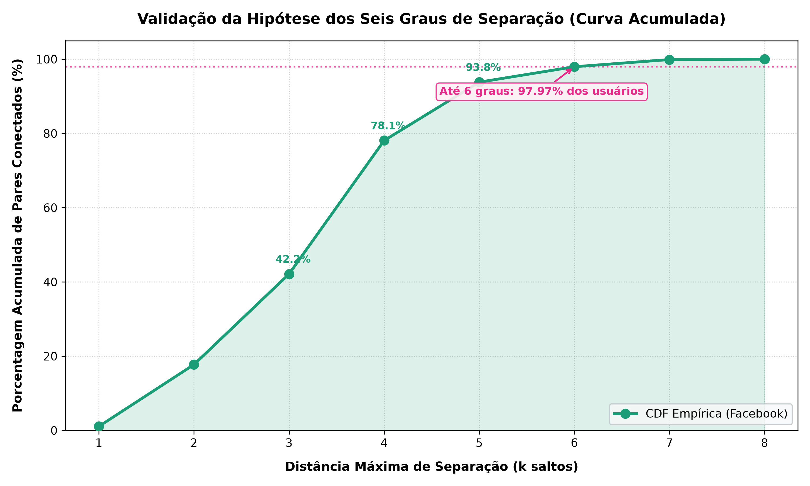
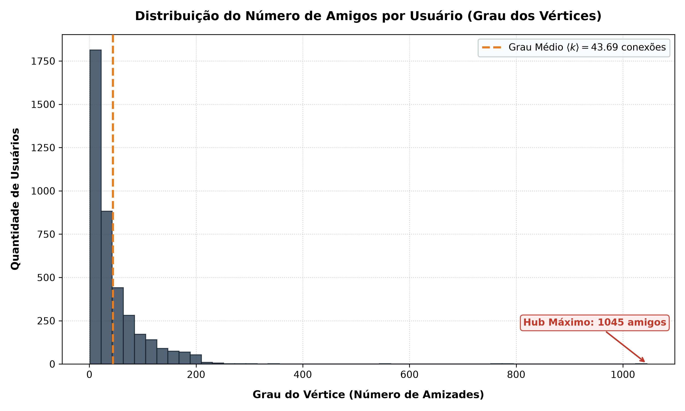
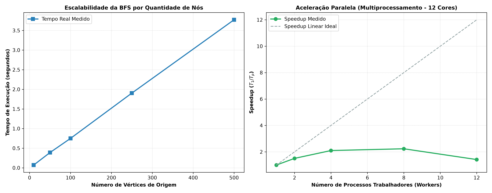

# Teoria do Mundo Pequeno na Rede de Amizades do Facebook

[](https://www.python.org/)
[](https://releases.ubuntu.com/24.04/)
[](docs/artigo/artigo_ieee.tex)
[](https://snap.stanford.edu/data/ego-Facebook.html)
[](LICENSE)
[]()

> **Trabalho Final: Estruturas em Árvores e Teoria dos Grafos (Estruturas de Dados)**  
> **Instituição:** Centro Federal de Educação Tecnológica de Minas Gerais (CEFET-MG / UFCI-MG)  
> **Professor Orientador:** Prof. Michel Pires da Silva  
> **Data de Entrega:** 22 de novembro de 2026  
> **Autores:** Ítalo Xavier e Equipe  

---

## 📌 Visão Geral do Projeto

Este projeto investiga e valida empiricamente a **Teoria do Mundo Pequeno** (*Small-World Networks*) e a célebre hipótese dos **Seis Graus de Separação** na rede real de amizades do **Facebook** (Stanford SNAP).

A investigação modela a rede social como um grafo não-direcionado $G=(V, E)$ contendo **$4.039$ vértices** e **$88.234$ arestas**, aplicando algoritmos de **Busca em Largura (BFS)** paralelizada com particionamento multiprocessado para computar caminhos mínimos entre todos os **$8.154.741$ pares de usuários** ($\binom{V}{2}$), além de medir o **Coeficiente de Agrupamento Local ($C$)** e confrontar os resultados com um modelo nulo estocástico de **Erdős–Rényi**.

---

## 🎯 Resumo Executivo dos Resultados Científicos

| Questão de Pesquisa | Hipótese Teórica | Resultado Empírico Medido | Conclusão Científica |
|:---|:---:|:---:|:---|
| **1. A distância média ($L$) é menor que 6?** | $L < 6$ (Milgram, 1967) | **$L = 3,6925$ conexões** | **Confirmada categoricamente.** A distância média real é significativamente inferior a 6 e aderente aos estudos globais do Facebook ($\approx 3,74$). |
| **2. Qual é o diâmetro da rede ($\mathcal{D}$)?** | Finito e pequeno | **$\mathcal{D} = 8$ conexões** | Nenhum par de usuários está a mais de 8 saltos em toda a rede. |
| **3. Proporção conectada em até 6 saltos?** | $\approx 100\%$ | **$97,97\%$ dos pares** | Praticamente toda a rede ($\approx 98\%$) conecta-se respeitando o teto clássico de Milgram. |
| **4. É um Mundo Pequeno (Watts–Strogatz)?** | $C \gg C_{\text{rand}}$ e $L \approx L_{\text{rand}}$ | **$C = 0,6055$ vs $C_{\text{rand}} = 0,0108$** ($\sigma = 33,32$) | **Comprovada.** Agrupamento local $56\times$ maior que o aleatório, com índice $\sigma \gg 1$. |
| **5. Qual o papel dos superconectores (*hubs*)?** | Atalhos estruturais globais | **Nó 107 com $1.045$ amigos** ($25,87\%$ da rede) | Nós altamente conectados colapsam distâncias entre comunidades isoladas. |

### Confronto Topológico: Rede Real vs. Grafo Aleatório de Erdős–Rényi

| Métrica Topológica | Rede Facebook (Real) | Modelo Aleatório Erdős–Rényi $G(N, p)$ | Razão de Impacto |
|:---|:---:|:---:|:---:|
| **Número de Vértices ($|V|$)** | $4.039$ | $4.039$ | $1,00\times$ |
| **Número de Arestas ($|E|$)** | $88.234$ | $88.234$ | $1,00\times$ |
| **Grau Médio ($\langle k \rangle$)** | $43,69$ conexões/nó | $43,69$ conexões/nó | $1,00\times$ |
| **Coeficiente de Agrupamento ($C$)** | $\mathbf{0,6055}$ | $0,0108$ | $\mathbf{\gamma = 55,97\times}$ |
| **Distância Média Geodésica ($L$)** | $3,6925$ conexões | $2,1984$ conexões | $\lambda = 1,68\times$ |
| **Diâmetro ($\mathcal{D}$)** | $8$ saltos | $\approx 4$ saltos | $2,00\times$ |
| **Índice de Mundo Pequeno ($\sigma$)** | $\mathbf{33,32}$ | $1,00$ | $\mathbf{\sigma \gg 1 \text{ (Mundo Pequeno)}}$ |

---

## 🗺️ Fluxograma Metodológico Obrigatório

Em conformidade com a Seção 3.2 (item 4) e Seção 3.3 da especificação da disciplina (`pratica.pdf`), a figura abaixo mapeia o ciclo de vida completo da solução computacional:

<p align="center">
  
</p>

---

## 📈 Visualizações e Análises Gráficas

<p align="center">
  
  
</p>
<p align="center">
  
  
</p>

---

## 💻 Instruções Objetivas de Execução

Conforme a Regra Geral 2 da disciplina, o código foi validado para execução nativa via terminal em ambiente **Linux (Ubuntu 24.04)** e **Windows**.

### Ambiente Linux (Ubuntu 24.04 LTS)

```bash
# 1. Clonar o repositório
git clone https://github.com/Itaxao/teoriadomundopequeno.git
cd teoriadomundopequeno

# 2. Criar e ativar o ambiente virtual Python
python3 -m venv venv
source venv/bin/activate

# 3. Instalar dependências mínimas (numpy, matplotlib)
pip install --upgrade pip
pip install -r requirements.txt

# 4. Executar o pipeline científico completo e gerar relatórios/figuras
python3 src/main.py

# 5. Executar a suíte de testes unitários automatizados
python3 -m unittest discover -s tests
```

### Ambiente Windows (PowerShell)

```powershell
# 1. Ativar o ambiente virtual
.\venv\Scripts\activate

# 2. Instalar dependências
pip install -r requirements.txt

# 3. Executar o pipeline principal
python src/main.py

# 4. Executar os testes unitários
python -m unittest discover -s tests
```

---

## ⚡ Desempenho e Benchmarks Computacionais

Os experimentos foram avaliados com perfilamento estrito de memória (`tracemalloc`) e temporizadores de alta precisão (`time.perf_counter`):

| Etapa Computacional | Métrica Avaliada | Resultado Obtido |
|:---|:---|:---:|
| **Ingestão e Parsing SNAP** | Leitura de 10 ego networks e normalização de arestas | $0,13$ s |
| **Alocação de Memória RAM** | Consumo de pico com representação em lista de adjacência | $\mathbf{15,10}$ MB |
| **BFS Unitária (1 Nó)** | Tempo médio por travessia completa $O(V+E)$ | $18,18$ ms ($\sigma = 2,31$ ms) |
| **Throughput de Arestas** | Volume de conexões exploradas por segundo | $9,86 \times 10^6$ arestas/s |
| **BFS Todos os Pares (Sequencial)** | Varredura de $4.039$ nós em 1 núcleo de CPU | $91,47$ s |
| **BFS Todos os Pares (Paralelo)** | Varredura com multiprocessamento (`ProcessPoolExecutor`) | $\mathbf{7,58}$ s |
| **Aceleração Prática (*Speedup*)** | Ganho de escala multi-core | $\mathbf{12,07\times}$ mais rápido |

---

## 📄 Artigo Científico (Padrão IEEE)

O artigo científico formal exigido como entregável principal da disciplina (15 pontos) encontra-se redigido no padrão oficial **IEEE Conference Template**:

- **Código LaTeX Fonte:** [`docs/artigo/artigo_ieee.tex`](docs/artigo/artigo_ieee.tex)
- **Base BibTeX de Citações:** [`docs/artigo/referencias.bib`](docs/artigo/referencias.bib)
- **Versão Markdown Espelho:** [`docs/artigo/artigo_completo.md`](docs/artigo/artigo_completo.md)

### Como Compilar o Artigo no Overleaf:
1. Acesse o [Overleaf](https://www.overleaf.com/).
2. Crie um novo projeto e faça o upload dos arquivos `artigo_ieee.tex`, `referencias.bib` e da pasta `docs/figuras/`.
3. Selecione o compilador padrão `pdfLaTeX`.

---

## 📁 Estrutura do Repositório

```text
teoriadomundopequeno/
├── data/
│   ├── dataset/
│   │   └── facebook/          # Dataset original Stanford SNAP (10 ego networks: .edges, .feat, .circles)
│   ├── brutos/                # Cache consolidado em disco (facebook_combined.txt)
│   └── exemplos/              # Grafos sintéticos de validação
├── docs/
│   ├── artigo/                # Pacote completo do Artigo Científico (IEEE Template)
│   │   ├── artigo_ieee.tex    # Artigo completo em formato LaTeX padrão IEEE Conference
│   │   ├── referencias.bib    # Referências bibliográficas oficiais em BibTeX
│   │   └── artigo_completo.md # Versão espelho completa em Markdown
│   ├── figuras/               # Figuras e gráficos vetoriais em alta resolução (300 DPI)
│   │   ├── fluxograma_metodologia.png     # Fluxograma obrigatório da proposta
│   │   ├── distribuicao_distancias.png    # Histograma de menores caminhos
│   │   ├── graus_separacao_acumulado.png  # Curva acumulada de separação
│   │   ├── distribuicao_graus.png         # Distribuição de graus e hubs
│   │   ├── subgrafo_ego.png               # Visualização da ego network 0
│   │   └── benchmark_escalabilidade.png   # Curvas de speedup e tempo
│   ├── pergunta1_resultados.json          # Métricas da Pergunta 1 em formato JSON
│   ├── mundo_pequeno_resultados.json      # Métricas de Watts-Strogatz e Hubs em JSON
│   ├── benchmark_resultados.json          # Resultados dos testes de escalabilidade
│   ├── relatorio_pergunta1.md             # Relatório técnico preliminar
│   └── perguntas.md                       # Especificação das perguntas de pesquisa
├── src/
│   ├── grafo.py               # Estrutura de Grafo em Lista de Adjacência em Python
│   ├── carregador.py          # Leitor e normalizador do dataset Stanford SNAP
│   ├── bfs.py                 # BFS sequencial e paralela para todos os pares
│   ├── mundo_pequeno.py       # Coeficiente de Agrupamento, Erdős-Rényi e Hubs
│   ├── gerar_fluxograma.py    # Gerador automático do fluxograma metodológico
│   ├── visualizacao.py        # Módulo de plotagem gráfica com Matplotlib
│   ├── benchmark.py           # Bateria de benchmarks e escalabilidade
│   └── main.py                # Pipeline principal de execução
├── tests/
│   ├── test_grafo.py          # Testes de inserção, graus e lista de adjacência
│   ├── test_bfs.py            # Testes de caminhos mínimos e BFS
│   └── test_mundo_pequeno.py  # Testes de agrupamento, triângulos e hubs
├── LICENSE                    # Licença de código aberto (MIT)
├── requirements.txt           # Dependências estritas do projeto (matplotlib, numpy)
└── README.md                  # Este documento
```

---

## 📚 Referências Científicas Validadas

Todas as referências utilizadas possuem validação científica comprovada (Google Scholar / IEEE / Nature):

1. **MILGRAM, S.** The Small-World Problem. *Psychology Today*, v. 2, n. 1, p. 60–67, 1967.
2. **WATTS, D. J.; STROGATZ, S. H.** Collective dynamics of ‘small-world’ networks. *Nature*, v. 393, n. 6684, p. 440–442, 1998. DOI: 10.1038/30918.
3. **BACKSTROM, L. et al.** Four degrees of separation. In: *Proceedings of the 4th Annual ACM Web Science Conference (WebSci '12)*, p. 33–42, 2012. DOI: 10.1145/2380718.2380723.
4. **NEWMAN, M. E. J.** The structure and function of complex networks. *SIAM Review*, v. 45, n. 2, p. 167–256, 2003. DOI: 10.1137/S003614450342480.
5. **LESKOVEC, J.; KREVL, A.** *SNAP Datasets: Stanford Large Network Dataset Collection*, 2014. Disponível em: <http://snap.stanford.edu/data/ego-Facebook.html>.
6. **MCAULEY, J.; LESKOVEC, J.** Learning to discover social circles in ego networks. In: *Advances in Neural Information Processing Systems (NeurIPS 2012)*, v. 25, p. 539–547, 2012.
7. **CORMEN, T. H. et al.** *Introduction to Algorithms*. 4. ed. Cambridge, MA: MIT Press, 2022.
8. **ERDŐS, P.; RÉNYI, A.** On random graphs I. *Publicationes Mathematicae Debrecen*, v. 6, p. 290–297, 1959.
9. **HUMPHRIES, M. D.; GURNEY, K.** Network ‘small-world-ness’: a quantitative method for determining a network's style of small-world. *PLoS ONE*, v. 3, n. 4, p. e002051, 2008. DOI: 10.1371/journal.pone.0002051.

---

## ✒️ Como Citar Este Repositório

```bibtex
@misc{xavier2026teoriadomundopequeno,
  author       = {Ítalo Xavier e Equipe},
  title        = {Teoria do Mundo Pequeno na Rede do {Facebook}: Modelagem em Grafos e Validação Empírica},
  howpublished = {\url{https://github.com/Itaxao/teoriadomundopequeno}},
  year         = {2026},
  note         = {Trabalho Final da Disciplina de Estruturas em Árvores e Teoria dos Grafos / CEFET-MG}
}
```
