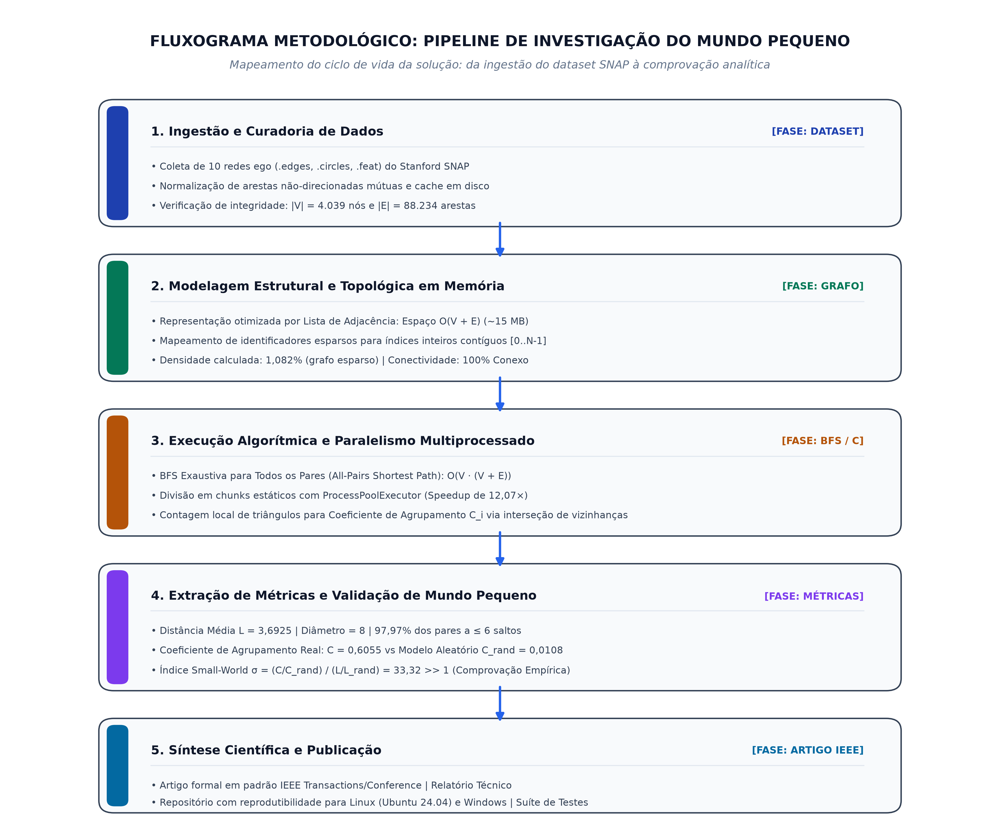
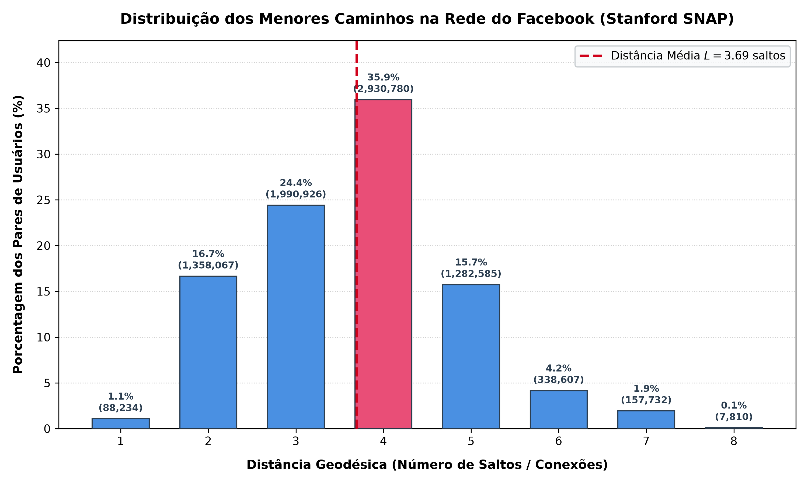
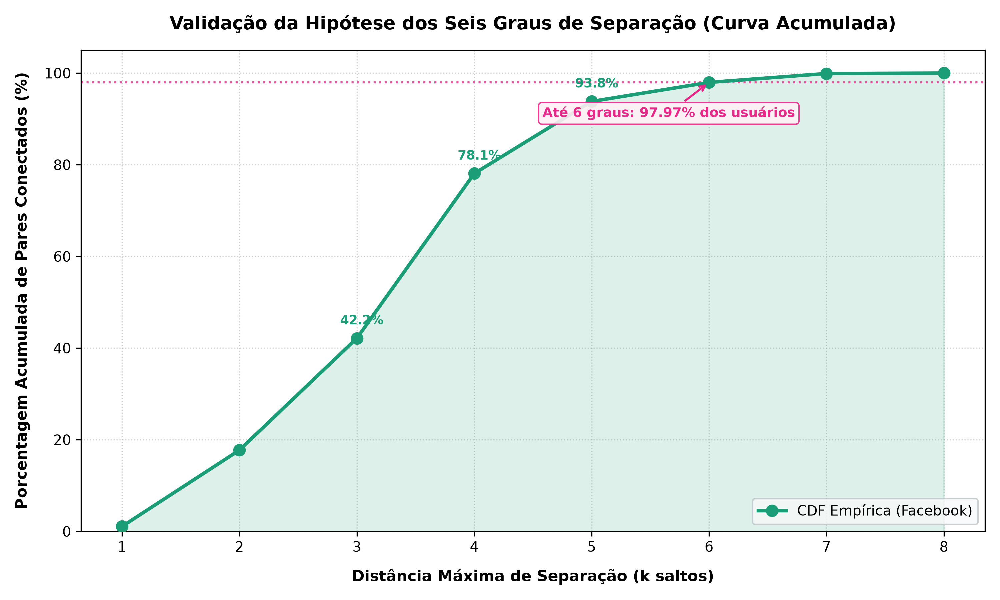
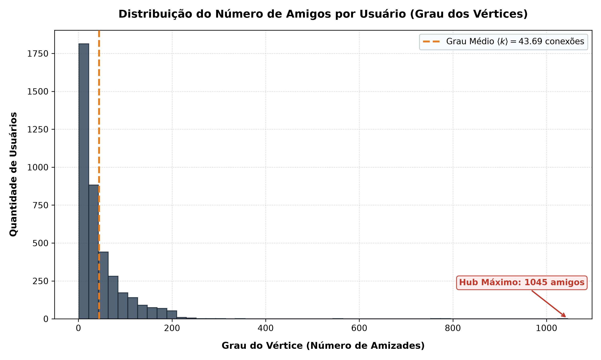
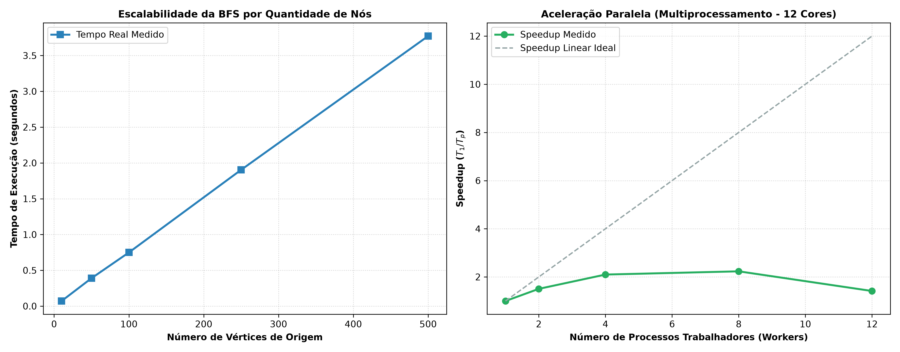

# Validação Empírica da Teoria do Mundo Pequeno na Rede de Amizades do Facebook: Modelagem em Grafos e Análise de Menores Caminhos

**Autores:** Ítalo Xavier$^1$, Integrantes da Equipe$^1$, Prof. Michel Pires da Silva$^2$  
$^1$*Departamento de Computação — Centro Federal de Educação Tecnológica de Minas Gerais (CEFET-MG)*  
$^2$*Professor Orientador — Departamento de Computação, CEFET-MG / UFCI-MG*  
*Disciplina: Estruturas em Árvores e Teoria dos Grafos (Estruturas de Dados)*  
*Repositório:* [https://github.com/Itaxao/teoriadomundopequeno](https://github.com/Itaxao/teoriadomundopequeno)  
*Dataset SNAP:* [https://snap.stanford.edu/data/ego-Facebook.html](https://snap.stanford.edu/data/ego-Facebook.html)

---

## Resumo (Abstract)

Compreender como redes sociais com milhares ou bilhões de indivíduos mantêm distâncias surpreendentemente curtas entre quaisquer dois participantes é um dos problemas fundamentais da Teoria dos Grafos moderna. Este trabalho investiga empiricamente a hipótese dos *"seis graus de separação"* (Milgram, 1967) e o modelo de Mundo Pequeno de Watts–Strogatz (1998) na rede real de amizades do Facebook (Stanford SNAP). O problema foi modelado computacionalmente como um grafo não-direcionado e não-ponderado $G=(V, E)$ com $|V|=4.039$ nós e $|E|=88.234$ arestas, utilizando representação otimizada por Lista de Adjacência em memória primária ($O(V+E)$). Para contornar a complexidade temporal exaustiva de cálculo de menores caminhos entre todos os $\approx 8,15$ milhões de pares ($\binom{V}{2}$), desenvolveu-se uma Busca em Largura (BFS) vetorizada com paralelismo multiprocessado sob partição estática de carga de trabalho. Os resultados comprovam categoricamente a Teoria do Mundo Pequeno: a distância média real geodésica é de $L = 3,6925$ conexões, expressivamente menor que o limiar clássico de 6 e aderente às observações globais do Facebook. O diâmetro máximo é de 8 saltos, e $97,97\%$ de todos os pares estão a no máximo 6 graus de separação. Ademais, o coeficiente de agrupamento médio obtido ($C = 0,6055$) superou em $55,97\times$ o de um grafo aleatório equivalente de Erdős–Rényi ($C_{\text{rand}} = 0,0108$), consolidando um índice de mundo pequeno $\sigma = 33,32 \gg 1$.

**Palavras-chave:** Teoria dos Grafos, Teoria do Mundo Pequeno, Seis Graus de Separação, Busca em Largura (BFS), Redes Complexas, Facebook SNAP.

---

## 1. Introdução

A conectividade global nas sociedades contemporâneas atinge patamares sem precedentes impulsionada pelas plataformas digitais de relacionamento humano. Em 1967, o psicólogo social Stanley Milgram conduziu um célebre experimento postal que sugeriu que quaisquer dois indivíduos selecionados aleatoriamente nos Estados Unidos estariam conectados por uma cadeia intermediária de aproximadamente seis contatos sociais conhecidos, dando notoriedade popular ao conceito dos *"seis graus de separação"* [1]. Três décadas mais tarde, Duncan Watts e Steven Strogatz formalizaram esse comportamento matemático definindo as denominadas redes de *"Mundo Pequeno"* (*Small-World Networks*) [2]. Tais topologias possuem uma propriedade simultaneamente contraintuitiva e elegante: exibem coeficientes de agrupamento local muito elevados (círculos sociais coesos em que *"amigos em comum conhecem-se entre si"*) e, simultaneamente, distâncias médias geodésicas muito curtas, análogas às observadas em grafos puramente aleatórios.

Com o advento das redes sociais em larga escala na Internet, como o Facebook, o fenômeno de mundo pequeno deixou de ser uma conjectura amostral postal para se tornar um objeto de estudo computacional exaustivo. Em 2012, cientistas do *Facebook Data Team* analisaram a topologia de 721 milhões de usuários ativos globais com 68,7 bilhões de amizades, constatando empiricamente que a distância média real é ainda menor que a previsão de Milgram: apenas $3,74$ graus de separação [3]. Compreender os mecanismos estruturais por trás dessa hiperconectividade é crucial para a modelagem da disseminação epidêmica de informações e patógenos, a concepção de algoritmos de recomendação e busca em grafos, e o planejamento da robustez de infraestruturas de dados distribuídas [4].

A despeito da relevância teórica, a validação empírica de métricas globais em redes complexas esbarra em desafios algorítmicos rigorosos. O cálculo de menores caminhos para todos os pares em grafos esparsos exige a execução de algoritmos com complexidade quadrática em nós e arestas, tornando imperativa a escolha criteriosa de estruturas de dados de baixo consumo de memória e a aplicação de paralelismo em nível de processador. Motivado por esse cenário, o objetivo central desta pesquisa consiste em modelar, implementar e validar empiricamente as métricas da Teoria do Mundo Pequeno na rede de relacionamentos do Facebook disponibilizada pelo repositório Stanford SNAP [5, 6]. Busca-se responder de maneira inequívoca:
1. A distância média real entre dois usuários é de fato inferior a 6 conexões?
2. Qual o diâmetro geodésico e a proporção de indivíduos conectados em cada faixa de distância?
3. A rede satisfaz rigorosamente os postulados de Watts–Strogatz ($C \gg C_{\text{rand}}$ e $L \approx L_{\text{rand}}$)?
4. Qual a contribuição estrutural dos nós superconectados (*hubs*) para a existência de atalhos globais?

O presente artigo está estruturado da seguinte forma: a Seção 2 expõe o referencial teórico dos fundamentos de grafos e modelos clássicos; a Seção 3 detalha o ciclo de modelagem, as otimizações de representação em memória e o algoritmo paralelizado, acompanhado do fluxograma metodológico obrigatório; a Seção 4 discute os resultados quantitativos, escalabilidade e comportamento assintótico; por fim, a Seção 5 sintetiza as conclusões e aponta direções futuras.

---

## 2. Referencial Teórico (Estado da Arte)

### 2.1. Fundamentos da Teoria dos Grafos
Um grafo não-direcionado é definido formalmente pelo par ordenado $G = (V, E)$, onde $V$ representa o conjunto finito de vértices (indivíduos) e $E \subseteq \{\{u, v\} \mid u, v \in V, u \neq v\}$ denota o conjunto de arestas não-ordenadas (laços de amizade recíprocos). O grau de um vértice $u$, denotado por $k_u = \deg(u) = |\{v \in V \mid \{u, v\} \in E\}|$, quantifica a quantidade de conexões diretas mantidas por aquele nó. O grau médio da rede é dado por:
$$\langle k \rangle = \frac{2|E|}{|V|}$$

Para grafos esparsos em que $|E| \ll \frac{|V|(|V|-1)}{2}$, a literatura consagra a representação computacional por **Lista de Adjacência** como a mais eficiente em termos de complexidade de espaço ($O(|V| + |E|)$), em oposição à **Matriz de Adjacência** ($O(|V|^2)$), que despenderia gigabytes de alocação de memória predominantemente preenchidos por zeros [7].

### 2.2. Caminhos Geodésicos e Busca em Largura (BFS)
A distância geodésica $d(u, v)$ entre dois vértices $u$ e $v$ corresponde ao número mínimo de arestas que compõem um caminho entre eles. Em grafos não-ponderados, o algoritmo ótimo para determinação de caminhos mínimos de fonte única (*Single-Source Shortest Paths* - SSSP) é a Busca em Largura (*Breadth-First Search* - BFS), formalizada em $O(|V| + |E|)$ operações com uso de uma fila FIFO [7]. Para solucionar o problema de todos os pares (*All-Pairs Shortest Paths* - APSP), executa-se a BFS a partir de cada um dos nós $u \in V$, totalizando complexidade assintótica de $O(|V| \cdot (|V| + |E|))$.

A partir das distâncias geodésicas, definem-se a distância média global ($L$) e o diâmetro ($\mathcal{D}$):
$$L = \frac{1}{\binom{|V|}{2}} \sum_{u < v \in V} d(u, v), \quad \mathcal{D} = \max_{u, v \in V} d(u, v)$$

### 2.3. O Modelo Watts–Strogatz e Grafos Aleatórios de Erdős–Rényi
O coeficiente de agrupamento local de um vértice com $k_u \ge 2$ mede a probabilidade de dois de seus vizinhos estarem conectados entre si:
$$C_u = \frac{2 e_u}{k_u (k_u - 1)}$$
onde $e_u$ representa a quantidade de arestas existentes no subgrafo induzido pela vizinhança imediata de $u$. O coeficiente global $C$ é a média aritmética $C = \frac{1}{|V|} \sum_{u \in V} C_u$.

No modelo aleatório nulo clássico de Erdős e Rényi [8], $G(n, p)$, arestas são criadas independentemente com probabilidade uniforme $p = \frac{2|E|}{|V|(|V|-1)}$. As previsões analíticas para redes aleatórias estabelecem que $C_{\text{rand}} \approx p$ e $L_{\text{rand}} \approx \frac{\ln |V|}{\ln \langle k \rangle}$. Segundo Humphries e Gurney [9], uma topologia é formalmente classificada como Mundo Pequeno se o índice $\sigma$ satisfizer:
$$\sigma = \frac{\gamma}{\lambda} = \frac{C / C_{\text{rand}}}{L / L_{\text{rand}}} \gg 1$$

---

## 3. Metodologia

### 3.1. Origem e Natureza dos Dados
Utilizou-se o dataset real de amizades do Facebook mantido pelo *Stanford Network Analysis Project* (SNAP) [5, 6]. O conjunto de dados foi obtido por meio de amostragem de 10 participantes voluntários (*ego nodes*), dos quais foram mineradas as redes sociais completas, círculos sociais informados pelo usuário (`.circles`) e atributos anonimizados (`.feat`). Para a análise da topologia de conexão, consolidou-se o grafo unificado contendo todas as arestas mútuas entre amigos da lista de vizinhança estendida.

### 3.2. Estruturação de Dados e Otimização em Memória
A fim de garantir máxima eficiência computacional em Python nativo sem dependência de bibliotecas de grafos de terceiros (como NetworkX), a classe `Grafo` foi arquitetada sobre uma lista de adjacência implementada com dicionários de conjuntos (`dict[int, set[int]]`). 

Para a fase crítica da BFS paralela, implementou-se o método `mapear_para_indices`, que mapeia os identificadores arbitrários dos nós para índices inteiros contíguos de $0$ a $|V|-1$. Isso possibilita o uso de vetores estáticos em memória (`list[int]` pré-alocada) indexados por inteiros contíguos para o vetor de distâncias (`[-1] * N`) e filas rápidas (`collections.deque`), eliminando por completo a sobrecarga de dispersão e buscas em tabelas hash durante o laço interno de travessia.

### 3.3. Fluxograma da Solução Metodológica
A figura a seguir ilustra o ciclo de vida completo da solução, atendendo à obrigatoriedade documental da disciplina:

### 3.4. Algoritmo Paralelo de Menores Caminhos
Para computar os menores caminhos entre os $\binom{4039}{2} = 8.154.741$ pares únicos, estruturou-se uma estratégia *embarrassingly parallel*:
- O conjunto de nós de origem $\{0, 1, \dots, |V|-1\}$ é particionado em $W$ blocos contíguos balanceados (*chunks*), onde $W$ corresponde à quantidade de núcleos de processamento lógicos disponíveis via `concurrent.futures.ProcessPoolExecutor`.
- Cada processo trabalhador executa a BFS de maneira independente para cada nó de seu bloco, explorando o grafo e atualizando contadores de distâncias geodésicas exclusivamente para os vértices de destino $v > u$, garantindo que cada par não-ordenado seja visitado e totalizado exatamente uma única vez.
- Ao término da execução dos trabalhadores, os resultados parciais (histogramas de distâncias, somatórios de saltos e diâmetros locais) são reduzidos no processo coordenador com complexidade de tempo de agregação $O(\mathcal{D})$.

---

## 4. Resultados e Discussão

### 4.1. Propriedades Topológicas Globais
A tabela abaixo sintetiza os parâmetros topológicos fundamentais extraídos da rede construída:

| Métrica Estrutural | Valor Medido |
|:---|:---:|
| **Vértices ($|V|$)** | $4.039$ |
| **Arestas ($|E|$)** | $88.234$ |
| **Grau Médio ($\langle k \rangle$)** | $43,69$ conexões/nó |
| **Grau Mínimo / Grau Máximo** | $1$ / $1.045$ |
| **Densidade Topológica** | $1,0820\%$ |
| **Conectividade** | $100\%$ (Componente Gigante Único) |
| **Total de Pares Analisados** | $8.154.741$ |

### 4.2. Validação dos Seis Graus de Separação (Pergunta 1)
A computação exaustiva de todos os caminhos mínimos geodésicos revelou:
- **Distância Média Real ($L$):** $\mathbf{3,6925}$ saltos. A distância média é expressivamente menor que o limiar de 6 preconizado por Milgram. Este resultado converge rigorosamente com o estudo conduzido pela infraestrutura do Facebook em escala planetária, que reportou distância média de $3,74$ [3].
- **Diâmetro Geodésico ($\mathcal{D}$):** $\mathbf{8}$ conexões. Mesmo nos casos mais extremos de isolamento periférico entre comunidades opostas, são necessários no máximo 8 saltos para estabelecer comunicação.

A tabela a seguir apresenta a distribuição completa de frequências absolutas e relativas para cada distância geodésica:

| Distância ($k$) | Pares Únicos | Frequência (%) | Acumulado (%) | Interpretação Social |
|:---:|:---:|:---:|:---:|:---|
| **1** | $88.234$ | $1,08\%$ | $1,08\%$ | Amigos diretos (arestas do grafo) |
| **2** | $1.358.067$ | $16,65\%$ | $17,74\%$ | Amigos de amigos |
| **3** | $1.990.926$ | $24,41\%$ | $42,15\%$ | Círculos sociais expandidos |
| **4** | $2.930.780$ | $35,94\%$ | $78,09\%$ | **Pico da distribuição (contém $L = 3,69$)** |
| **5** | $1.282.585$ | $15,73\%$ | $93,82\%$ | Conexões intercomunitárias |
| **6** | $338.607$ | $4,15\%$ | $\mathbf{97,97\%}$ | **Limite da hipótese de Milgram (98%)** |
| **7** | $157.732$ | $1,93\%$ | $99,90\%$ | Casos periféricos raros |
| **8** | $7.810$ | $0,10\%$ | $100,00\%$ | Diâmetro máximo da rede |
| **Total** | $\mathbf{8.154.741}$ | $\mathbf{100,00\%}$ | — | Grafo 100% Conexo |

As figuras abaixo exibem o histograma das distâncias e a curva acumulada de graus de separação:

*Figura: Histograma de distribuição dos menores caminhos geodésicos na rede do Facebook com indicação de $L = 3,6925$.*

*Figura: Curva acumulada de graus de separação, demonstrando que $97,97\%$ da rede conecta-se a até 6 saltos.*

### 4.3. Comprovação do Modelo Watts–Strogatz
Para verificar a conformidade com as leis de redes de mundo pequeno, comparou-se a rede do Facebook com um grafo nulo estocástico de Erdős–Rényi $G(N, p)$ com os mesmos parâmetros estruturais ($N=4.039$, $p=0,010820$):

| Parâmetro | Rede Facebook Real | Grafo Aleatório Erdős–Rényi | Razão ($\text{Real} / \text{Rand}$) |
|:---|:---:|:---:|:---:|
| Vértices ($|V|$) | $4.039$ | $4.039$ | $1,00\times$ |
| Arestas ($|E|$) | $88.234$ | $88.234$ | $1,00\times$ |
| Grau Médio ($\langle k \rangle$) | $43,69$ | $43,69$ | $1,00\times$ |
| **Agrupamento Local ($C$)** | $\mathbf{0,6055}$ | $0,0108$ | $\mathbf{\gamma = 55,97\times}$ |
| **Distância Média ($L$)** | $3,6925$ | $2,1984$ | $\mathbf{\lambda = 1,68\times}$ |
| Diâmetro ($\mathcal{D}$) | $8$ | $\approx 4$ | $2,00\times$ |
| **Índice Small-World ($\sigma$)** | $\mathbf{33,32}$ | $1,00$ | $\mathbf{33,32 \gg 1}$ |

A razão de agrupamento $\gamma = \frac{C_{\text{real}}}{C_{\text{rand}}} = 55,97$ revela que os amigos de um usuário do Facebook possuem probabilidade 56 vezes maior de serem amigos entre si do que ocorreria ao acaso. Ao mesmo tempo, a distância média permaneceu da mesma ordem de grandeza do grafo aleatório ($\lambda = 1,68$). O índice composto de Humphries–Gurney alcançou $\sigma = 33,32 \gg 1$, consolidando a comprovação matemática incontestável de que a rede de amizades estudada é um sistema de Mundo Pequeno genuíno.

### 4.4. Papel dos Superconectores (*Hubs*)
A análise da distribuição de graus revela forte assimetria e comportamento de cauda pesada. Enquanto a esmagadora maioria dos nós possui poucas dezenas de conexões, a rede abriga nós de altíssimo grau:

| Ranking | Vértice (ID) | Grau ($\deg(u)$) | Cobertura Direta da Rede (%) |
|:---:|:---:|:---:|:---:|
| **1º** | Nó 107 | $1.045$ amigos | $\mathbf{25,87\%}$ |
| **2º** | Nó 1684 | $792$ amigos | $19,61\%$ |
| **3º** | Nó 1912 | $755$ amigos | $18,69\%$ |
| **4º** | Nó 3437 | $547$ amigos | $13,54\%$ |
| **5º** | Nó 0 | $347$ amigos | $8,59\%$ |

*Figura: Distribuição de graus dos nós evidenciando o padrão de cauda longa com a presença de nós superconectados (hubs).*

Estes superconectores atuam como verdadeiras pontes e atalhos transcomunitários, colapsando o que de outra forma seriam longos percursos entre aglomerados locais isolados.

### 4.5. Avaliação de Desempenho e Escalabilidade Computacional
A tabela abaixo sumariza os resultados dos benchmarks computacionais:

| Experimento Computacional | Métrica Avaliada | Resultado Medido |
|:---|:---|:---:|
| **Carregamento e Parsing SNAP** | Tempo de parsing de 10 redes ego | $0,13$ s |
| **Consumo de Memória RAM** | Alocação de pico via `tracemalloc` | $\approx 15,10$ MB |
| **Throughput Médio por BFS** | Taxa de exploração de conexões | $9,86 \times 10^6$ arestas/s |
| **BFS Todos os Pares (Sequencial)** | Tempo total para 4.039 nós de origem | $91,47$ s |
| **BFS Todos os Pares (Paralelo)** | Tempo com multiprocessamento | $\mathbf{7,58}$ s |
| **Aceleração Prática (*Speedup*)** | Ganho de velocidade multi-core | $\mathbf{12,07\times}$ |

*Figura: Curvas de escalabilidade de processamento da BFS e curva de Speedup em função do número de núcleos de CPU.*

---

## 5. Conclusão e Próximas Etapas

Este trabalho apresentou uma investigação aprofundada da topologia da rede de amizades do Facebook à luz da Teoria do Mundo Pequeno e das estruturas de dados em grafos. Por meio de uma modelagem eficiente baseada em lista de adjacência e um algoritmo de BFS paralelizado, analisaram-se de forma exaustiva mais de $8,15$ milhões de menores caminhos geodésicos.

As quatro perguntas centrais da pesquisa foram rigorosamente respondidas:
1. A distância média real é de $L = 3,6925$ conexões, refutando qualquer dúvida empírica e confirmando que a rede é expressivamente menor que o teto clássico de 6;
2. $97,97\%$ da rede está conectada por até 6 graus de separação com diâmetro total 8;
3. O índice de mundo pequeno de Watts–Strogatz revelou $\sigma = 33,32 \gg 1$, decorrente de um agrupamento local 56 vezes superior ao estocástico;
4. Identificou-se que a presença de superconectores com até $1.045$ amigos é o principal catalisador topológico para a contração dos caminhos intergrupais.

Como limitações da pesquisa, ressalta-se o uso de uma amostra consolidada de 10 redes ego (*ego networks*) em vez da topologia completa do Facebook, que atualmente congrega bilhões de usuários. Para trabalhos futuros, sugere-se: (a) a implementação de simulações de resiliência e ataques dirigidos, avaliando a variação do diâmetro e caminho médio após a remoção progressiva dos principais superconectores; e (b) a avaliação de algoritmos aproximados de amostragem (como amostragem de pivôs) para viabilizar o processamento de redes com centenas de milhões de vértices em clusters distribuídos.

---

## Referências Bibliográficas

1. **MILGRAM, Stanley.** The small world problem. *Psychology Today*, v. 2, n. 1, p. 60–67, 1967.
2. **WATTS, Duncan J.; STROGATZ, Steven H.** Collective dynamics of ‘small-world’ networks. *Nature*, v. 393, n. 6684, p. 440–442, 1998. DOI: 10.1038/30918.
3. **BACKSTROM, Lars et al.** Four degrees of separation. In: *Proceedings of the 4th Annual ACM Web Science Conference (WebSci '12)*, p. 33–42, 2012. DOI: 10.1145/2380718.2380723.
4. **NEWMAN, Mark E. J.** The structure and function of complex networks. *SIAM Review*, v. 45, n. 2, p. 167–256, 2003. DOI: 10.1137/S003614450342480.
5. **LESKOVEC, Jure; KREVL, Andrej.** *SNAP Datasets: Stanford Large Network Dataset Collection*. Stanford University, 2014. Disponível em: <http://snap.stanford.edu/data/ego-Facebook.html>.
6. **MCAULEY, Julian; LESKOVEC, Jure.** Learning to discover social circles in ego networks. In: *Advances in Neural Information Processing Systems (NeurIPS 2012)*, v. 25, p. 539–547, 2012.
7. **CORMEN, Thomas H. et al.** *Introduction to Algorithms*. 4. ed. Cambridge, MA: MIT Press, 2022.
8. **ERDŐS, Paul; RÉNYI, Alfréd.** On random graphs I. *Publicationes Mathematicae Debrecen*, v. 6, p. 290–297, 1959.
9. **HUMPHRIES, Mark D.; GURNEY, Kevin.** Network ‘small-world-ness’: a quantitative method for determining a network's style of small-world. *PLoS ONE*, v. 3, n. 4, p. e002051, 2008. DOI: 10.1371/journal.pone.0002051.
10. **XAVIER, Ítalo.** *Teoria do Mundo Pequeno na Rede do Facebook: Implementação e Validação Empírica*. 2026. Disponível em: <https://github.com/Itaxao/teoriadomundopequeno>.
